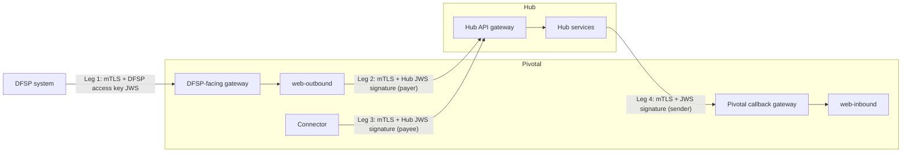

# Overview

> Applies to: Pivotal v1.4.0 and later, Helm chart 0.3.0 · Profile: both · Document version 1.0 (draft)

## Summary

Pivotal sits between DFSPs and the Mojaloop Hub. Messages cross it on four connections, called
**legs**. Each leg is protected twice: mutual TLS proves which system is on the other end of the
connection, and a JWS signature proves which DFSP sent each message. Pivotal runs two separate
certificate authorities of its own, one for each side, and trusts the Hub operator's CA for the
Hub's certificates.

## The four legs

| Leg | Direction | mTLS: who presents what | JWS: who signs, who verifies |
|---|---|---|---|
| 1. DFSP-facing | DFSP → web-outbound | The DFSP presents its **DFSP client certificate** (issued by the DFSP CA). | The DFSP signs with its **DFSP access key**; web-outbound verifies. |
| 2. Hub-facing, requests | web-outbound → Hub | Pivotal presents the **Hub client certificate** (issued by the Hub CA) and checks the Hub's server certificate against the **Hub CA bundle**. | web-outbound signs `POST /quotes` and `POST /transfers` as the payer DFSP, with that tenant's **Hub JWS signing key**. `GET` requests have no body and are not signed. The receiving DFSP verifies (and the Hub, if its operator turns that on). |
| 3. Hub-facing, callbacks out | Connector → Hub | Same as leg 2. | The connector signs its `PUT` callbacks as the payee DFSP, with that tenant's **Hub JWS signing key**. The receiving DFSP verifies (and the Hub, if its operator turns that on). |
| 4. Hub-facing, inbound | Hub → web-inbound | The Hub presents the **Hub callback certificate** (signed by the Pivotal Hub-client CA). The Pivotal callback gateway presents the **web-inbound server certificate** (also from the Pivotal Hub-client CA). | The sender signs (the Hub, or a peer or tenant DFSP); web-inbound verifies, according to the verify mode set for that sender. |

The connector does not verify signatures on what it receives.

## Two trust domains

| Domain | CA | Protects |
|---|---|---|
| Pivotal's | **DFSP CA** (`pki_dfsp`) | Leg 1: DFSP client certificates |
| Pivotal's | **Pivotal Hub-client CA** (`pki_hub_client`) | Leg 4: the web-inbound server certificate and the Hub callback certificate |
| The Hub's | **Hub CA** | Legs 2 and 3: the Hub's server certificate and Pivotal's Hub client certificate |

Pivotal's two CAs are kept separate on purpose. If they were one, a DFSP client certificate would
also be trusted on the Hub-facing side.

## Components

| Component | Role in mTLS and JWS |
|---|---|
| DFSP-facing gateway (Istio) | Terminates mTLS from DFSPs, checks the certificate against the DFSP CA, and passes a description of it to web-outbound. |
| web-outbound | Checks that the DFSP client certificate belongs to the DFSP named in `FSPIOP-Source`, verifies the DFSP access key signature, signs requests to the Hub, and presents the Hub client certificate. |
| Connector | Signs callbacks to the Hub and presents the Hub client certificate. One connector per DFSP. |
| Pivotal callback gateway (Istio) | Terminates mTLS from the Hub, checks the Hub callback certificate, and presents the web-inbound server certificate. |
| web-inbound | Verifies the JWS signature on Hub callbacks, according to each sender's verify mode. Holds no signing key. |
| web-pivotal and the portal | Issue and revoke DFSP client certificates, register DFSP access keys, onboard DFSPs, and set each DFSP's signing and verify settings. |
| trust-manager ([details](trust-manager.md)) | Gets and renews the Hub client certificate; signs and renews the Hub callback certificate; keeps the Hub CA bundle up to date; publishes the DFSP CA to the DFSP-facing gateway; registers Pivotal's CA and each tenant's public JWS key in MCM; downloads peers' public JWS keys from MCM. |
| Vault | Holds Pivotal's intermediate CAs and signs certificates with them. Holds the Hub JWS signing keys (`vault-kv`) or references to them and HSM credentials (`pkcs11`). |
| cert-manager | Issues and renews the web-inbound server certificate through Vault. |
| MCM | The Hub's registry. Pivotal enrolls its Hub client certificate there, registers its CA and public keys, and reads the Hub CA and peers' public keys from it. |
| AWS KMS or AWS CloudHSM | Holds the root CA keys. With `pkcs11`, CloudHSM also holds every Hub JWS signing key and performs the signing. |

## What this means for you

- You set up and operate **four** legs, not one. Each has its own certificates, and each can be
  turned on separately.
- The Hub operator owns the Hub CA and the Hub-side configuration. You need their cooperation for
  legs 2, 3 and 4.
- Most renewals are automatic. The CA roots, the DFSP client certificates and the keys are not;
  see [Certificates and keys](certificates-and-keys.md).

## References

- [Certificates and keys](certificates-and-keys.md)
- [Security model](security-model.md)
- [Glossary](../reference/glossary.md)
