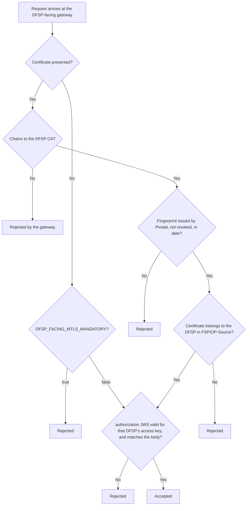

# Security Model

> Applies to: Pivotal v1.4.0 and later, Helm chart 0.3.0 · Profile: both · Document version 1.0 (draft)

## Summary

On every leg, mTLS answers "which system is connecting?" and JWS answers "which DFSP sent this
message, and was it changed?". On the DFSP-facing side Pivotal also checks that both answers name the
same DFSP. Once `DFSP_FACING_MTLS_MANDATORY=true`, an attacker needs two stolen credentials of the
same DFSP, not one. This page explains
who signs and who verifies on each leg, what each control stops, and what you, the operator, are
responsible for.

## Who signs and who verifies

| Leg | Signs | With | Verifies | Against |
|---|---|---|---|---|
| 1. DFSP → web-outbound | The DFSP | DFSP access key | web-outbound | The public key registered for the DFSP named in `FSPIOP-Source` |
| 2. web-outbound → Hub | web-outbound, as the payer | The tenant's Hub JWS signing key | The receiving DFSP (and the Hub, if its operator turns that on) | The tenant's public key in MCM |
| 3. Connector → Hub | The connector, as the payee | The tenant's Hub JWS signing key | The receiving DFSP (and the Hub, if its operator turns that on) | The tenant's public key in MCM |
| 4. Hub → web-inbound | The sender: a DFSP (a peer or another tenant), or the Hub | The sender's key | web-inbound | The sender's public key (peers' keys are downloaded from MCM; tenants' keys come from Pivotal's own record; the Hub's key is registered on **Hub → Hub JWS Public Key**), according to the sender's verify mode |

The connector does not verify signatures on messages it receives.

The Hub's own messages, such as error callbacks, can arrive unsigned. Keep the Hub's source at
`verify-if-present` unless the Hub operator confirms the Hub signs everything it sends.

## Trust chains

| Leg | Client certificate chains to | Server certificate chains to |
|---|---|---|
| 1 | DFSP CA (checked by the DFSP-facing gateway) | Your DFSP-facing gateway certificate (outside this guide) |
| 2 and 3 | Hub CA (checked by the Hub API gateway) | Hub CA (checked by Pivotal with the Hub CA bundle) |
| 4 | Pivotal Hub-client CA (checked by the Pivotal callback gateway) | Pivotal Hub-client CA (checked by the Hub, which gets Pivotal's CA from MCM) |

## What each control stops

| Control | Stops | Does not stop |
|---|---|---|
| mTLS | Connections from systems that do not hold a certificate from a trusted CA (on leg 1, only once `DFSP_FACING_MTLS_MANDATORY=true`) | A legitimate participant claiming to be a different DFSP in the message |
| JWS | Messages that were changed in transit, or that claim a sender whose key the signer does not hold | A stolen signing key being used from any system |
| Certificate-to-source binding (leg 1) | A DFSP using its own valid certificate with another DFSP's stolen access key | An attacker holding both credentials of the same DFSP. A caller that presents no certificate while `DFSP_FACING_MTLS_MANDATORY` is `false`. |
| Replay protection (`/secured/transferStatus` only) | The same signed status request being sent twice. Each request carries a date (accepted within ±5 minutes) and a single-use nonce. | Replay on other endpoints |

### Leg 1 in order

A certificate that is presented is always checked in full. `DFSP_FACING_MTLS_MANDATORY` decides
only what happens when no certificate is presented. This lets DFSPs move to mTLS one at a time.
**Until it is `true`, revoking a certificate does not cut a DFSP off**: the DFSP can stop presenting
it and still be admitted on its access key alone.

### Turning protections on gradually

- **Signing, leg 2** needs `FSPIOP_USE_JWS=true` on web-outbound, and signing turned on for the
  tenant. trust-manager turns a tenant's signing on once MCM holds its public key.
- **Signing, leg 3** needs only `FSPIOP_USE_JWS=true` on the connector and a key it can read. The
  connector has no per-tenant switch, so turn it on only after the tenant's public key is in MCM.
- **Verification (leg 4)** needs `FSPIOP_USE_JWS=true` on web-inbound, then a mode per sender: `off`, `verify-if-present` (a signature that is
  present must be valid; a missing one is accepted) or `require`. Move each sender to `require` once
  it signs everything.

## What each profile relies on

| | `vault-kv` (KMS-backed) | `pkcs11` (HSM-backed) |
|---|---|---|
| Root CA keys | In AWS KMS; cannot be exported | In AWS CloudHSM; cannot be exported |
| Hub JWS private keys | Stored in Vault. Loaded into the memory of the services that sign. | Never leave the HSM. Services ask the HSM to sign. |
| What keeps tenants apart | Vault policies: each connector can read only its own tenant's key; web-outbound and web-pivotal can reach every tenant's key path (web-outbound signs for all tenants; web-pivotal creates the keys) | HSM ownership: each tenant's key is owned by its own crypto user and shared only with web-outbound's crypto user. web-pivotal reads only key references and public keys: it holds no crypto-user credential and cannot reach the HSM. |
| What an attacker with full access to a running service gets | The keys that service can read | The crypto-user password the service holds, so they can sign from anywhere that reaches the HSM until that password is changed, but never copy the key |
| Who must be trusted most | Anyone who can read the Vault KV paths | Custodians (the Crypto Officer can reset any crypto user's password, and so could sign as any tenant), and anyone who can read the HSM credential paths in Vault |

## What you are responsible for

- **Keep the two Pivotal CAs separate,** as the CA ceremony creates them.
- **Restrict who can change trust anchors.** Whoever can write the Hub CA bundle, the DFSP CA bundle
  in the gateway namespace, the `-cacert` Secrets, or `pivotal-hub-client-ca` decides which CA
  Pivotal trusts, and which CA the Hub trusts for leg 4.
- **Keep the DFSP-facing gateway on `SANITIZE_SET`** for `x-forwarded-client-cert`. Any other mode
  lets a caller forge the certificate details web-outbound checks.
- **Restrict Vault access** to the policies this guide sets up, and review Vault's audit log.
- **Set `DFSP_FACING_MTLS_MANDATORY=true`** once every DFSP presents a certificate.
- **Move each DFSP sender to `require`** once it signs everything.
- **Protect custodian credentials** (`pkcs11`): Crypto Officer and ceremony credentials are never
  stored in Vault or in any service.
- **Keep the DFSP-facing endpoint behind your network controls** while mTLS is optional.
- **Coordinate with the Hub operator** for the Hub CA, the Hub client certificate and the Hub's
  own JWS settings.

## What this means for you

- Turn on mTLS and JWS leg by leg, using the gradual settings above, and finish by making both
  mandatory.
- Choose the profile by who you trust with keys; see [Choosing a profile](choosing-a-profile.md).

## References

- [Overview](overview.md)
- [Certificates and keys](certificates-and-keys.md)
- [Known limitations](../known-limitations.md)
