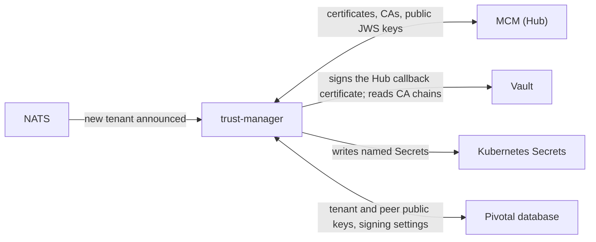

# trust-manager

> Applies to: Pivotal v1.4.0 and later, Helm chart 0.3.0 · Profile: both · Document version 1.0 (draft)

## Summary

trust-manager is the Pivotal service that keeps certificates, CA bundles and public keys in step
between the Hub (through MCM), Vault, Kubernetes and Pivotal's database. Without it, an operator
would have to copy each of these by hand and remember to renew them. It handles no transfers and
is not in any request path: it is a control plane that runs scheduled jobs. If it stops, transfers
continue, but renewals, new tenants and peer key updates wait until it runs again.

## Why it exists

mTLS and JWS need the same facts in several places at once:

- The Hub must hold Pivotal's CA and each tenant's public JWS key.
- Pivotal must hold the Hub's CA and every peer's public JWS key.
- The gateways must hold the right trust anchors, and Pivotal's certificates must be renewed before
  they expire.

trust-manager does each of these on a schedule, so they stay correct without manual steps.

## What it connects

## What it does

Each job is described in one sentence here. Intervals, lock keys and log lines are in
[Scheduled jobs](../reference/scheduled-jobs.md).

| Job | What it keeps correct | Leg |
|---|---|---|
| Hub client certificate | Gets Pivotal's client certificate from the Hub CA through MCM, and renews it 30 days before it expires. | 2, 3 |
| Hub CA sync | Copies the Hub's CA into the Hub CA bundle, so Pivotal can check the Hub's server certificate. | 2, 3 |
| MCM CA registration | Registers the Pivotal Hub-client CA in MCM, so the Hub trusts Pivotal's callback gateway. | 4 |
| Hub callback certificate | Signs the certificate the Hub presents when it calls Pivotal, and hands it to the Hub through MCM. Renews it 30 days before it expires. Off unless configured. | 4 |
| DFSP CA publish | Writes the DFSP CA into the DFSP-facing gateway's trust anchor. Off unless configured. | 1 |
| JWS key publish | Publishes each tenant's public JWS key to MCM, then turns the tenant's signing on once. | 2, 3 |
| Peer JWS sync | Downloads every other participant's public JWS key from MCM, so web-inbound can verify them. | 4 |
| Signing-tenant consumer | Publishes a newly onboarded tenant's key within seconds, instead of waiting for the hourly job. Needs NATS. | 2, 3 |

When `MCM_AUTO_REGISTER_DFSPS=true`, trust-manager also creates a tenant in MCM if the Hub does not
know it yet.

## How it runs

- **No HTTP listener.** Nothing calls trust-manager. It only calls out.
- **Timer jobs.** Each job runs once at startup, then on its interval. A failed run is retried on
  the next run.
- **One runner per job.** With more than one replica, a Redis lock lets only one replica run each
  job. The chart deploys one replica by default.
- **No database migrations.** It uses tables that web-pivotal creates.
- **It never overwrites a key MCM already holds.** If MCM and Pivotal hold different public keys for
  a tenant, trust-manager logs a warning and changes nothing.

## What it can access

| System | Access | Used for |
|---|---|---|
| MCM | Client credentials (`MCM_CLIENT_ID`, `MCM_CLIENT_SECRET`) | Every Hub-facing job |
| Vault | Its own Vault role. The only authenticated call is signing on `pki_hub_client/sign/hub-callback-client`. CA chains are read without a token. | Hub callback certificate; CA chains for MCM registration and DFSP CA publish |
| Kubernetes | In its own namespace: update the Hub client certificate and Hub CA bundle Secrets by name, and create Secrets (Kubernetes cannot limit `create` to one name). In the DFSP-facing gateway's namespace: update only the trust anchor Secret, which must already exist. | Writing certificates and trust anchors |
| Files | The Pivotal Hub-client CA root, mounted from the `pivotal-hub-client-ca` Secret (`PIVOTAL_CA_PATH`) | MCM CA registration |
| Database | Tenant and peer rows in `participant_key` | Public keys and signing settings |

It never reads a tenant's private JWS key.

## If it is down

| How long | Effect |
|---|---|
| Minutes to hours | None on transfers. New peers' keys and new tenants' keys wait. |
| Longer than the renewal window (30 days before expiry) | Certificates are not renewed. When the Hub client certificate or the Hub callback certificate expires, the Hub-facing legs fail. |
| After a CA change at the Hub | The Hub CA bundle is not updated, so Pivotal stops trusting the Hub's server certificate. |

Check that it is healthy with [Check certificate renewals](../runbooks/common/check-certificate-renewals.md).

## What this means for you

- Deploy exactly one trust-manager (the chart's default) and keep it running.
- Give it only the access listed above. Whoever controls its MCM credentials or the
  `pivotal-hub-client-ca` Secret controls which CA the Hub trusts for Pivotal.
- After a restart, it runs every job straight away. A Hub callback certificate that still has to be
  handed to the Hub is retried after a restart too.

## References

- [Overview](overview.md)
- [Certificates and keys](certificates-and-keys.md)
- [Scheduled jobs](../reference/scheduled-jobs.md)
- [Environment variables](../reference/environment-variables.md)
- [MCM endpoints](../reference/mcm-endpoints.md)
- [Troubleshooting: trust-manager and MCM](../troubleshooting.md#trust-manager-and-mcm)
