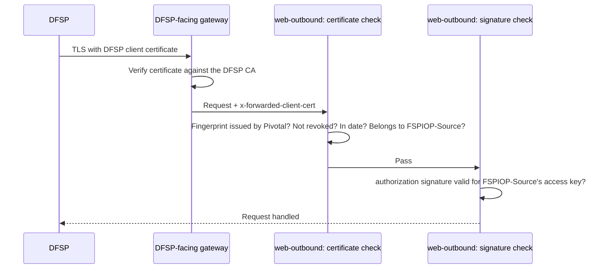

# Enable DFSP-Facing mTLS and JWS (Leg 1)

> Applies to: Pivotal v1.0.1 – v1.3.0, Helm chart 0.2.0 · Profile: both · Document version 1.0 (draft)

## Overview

Leg 1 is the connection from a DFSP to Pivotal's web-outbound service. Two controls protect it:

- **mTLS.** The DFSP presents a DFSP client certificate issued by the DFSP CA. The DFSP-facing gateway
  verifies it and passes its fingerprint to web-outbound in the `x-forwarded-client-cert` header.
  web-outbound looks the fingerprint up on every request and checks that the certificate belongs to
  the participant named in `FSPIOP-Source`.
- **JWS.** The DFSP signs each request with its DFSP access key and sends the signature in the
  `authorization` header. web-outbound verifies it with the DFSP's registered public key.



The JWS check is on by default (`ACCESS_JWT_ENABLED` defaults to `true`). This page adds the
certificate check, first in **optional** mode and then in **mandatory** mode.

## Objective

Make every DFSP connect with its own DFSP client certificate, and refuse a request whose certificate
and `FSPIOP-Source` name different participants.

## Expected Outcome

- The DFSP-facing gateway asks for a client certificate and verifies it against the DFSP CA.
- trust-manager keeps the gateway's trust anchor in step with Vault.
- A DFSP's certificate is accepted only for that DFSP's own `FSPIOP-Source`.
- After the final step, a caller without a certificate is refused.

## Prerequisites

### Mandatory

- Your profile's Deploy Pivotal page verified: [vault-kv](../vault-kv/4-deploy-pivotal.md) or
  [pkcs11](../pkcs11/5-deploy-pivotal.md).
- Two DFSPs onboarded, each with an access public key registered, called `<DFSP_A>` and `<DFSP_B>`
  below: the "Onboard test DFSPs" step of your setup sequence ([vault-kv](../vault-kv/index.md),
  [pkcs11](../pkcs11/index.md)).
- A server TLS certificate for the DFSP-facing host, as a Secret in the gateway's namespace, and a DNS
  record for the host. This page calls the Secret `<DFSP_GATEWAY_CREDENTIAL>` (see the
  [shared worksheet](hub-operator-and-worksheet.md#step-3-fill-in-the-worksheet)). **It must be used
  by this host only** (see Step 1).
- How DFSPs sign their requests: [DFSP request signing](../../reference/dfsp-request-signing.md).
- A portal account with the permissions `participant.certificate.enroll`,
  `participant.certificate.view` and `participant.certificate.revoke`.
- `VAULT_ADDR` set in your shell.

### Optional

- An Istio AuthorizationPolicy that limits which source addresses may reach the DFSP-facing host.
  Recommended while certificates are optional (Steps 2 to 7): until then, a DFSP that presents no
  certificate is still admitted, so the host must not be reachable more widely than intended.

## Steps

### Step 1. Create the gateway's trust anchor

- **Purpose:** Istio verifies client certificates against a companion Secret named after the
  gateway's credential with `-cacert` added, in the gateway's namespace. trust-manager updates this
  Secret later, but it must exist first: trust-manager is allowed to update it, not create it.
- **Action:** Read the DFSP CA's intermediate certificate from Vault and create the Secret.
- **Command or Configuration:**

  ```bash
  curl -s "$VAULT_ADDR/v1/pki_dfsp/ca_chain" > dfsp-ca.pem
  openssl x509 -in dfsp-ca.pem -noout -subject      # expect the DFSP CA intermediate

  kubectl -n <GATEWAY_NAMESPACE> create secret generic <DFSP_GATEWAY_CREDENTIAL>-cacert \
    --from-file=cacert=dfsp-ca.pem
  rm dfsp-ca.pem
  ```

- **Expected Result:** The subject contains `Pivotal DFSP-Facing CA Intermediate`, then
  `secret/<DFSP_GATEWAY_CREDENTIAL>-cacert created`.
- **If It Fails:** An empty file means the ceremony did not install the intermediate in `pki_dfsp`.

> **Give this host its own credential.** The anchor follows the credential name. If another host
> (the portal, or the Pivotal callback gateway) uses the same credential, it gets the same anchor,
> and a DFSP certificate would be accepted there too. Do not use a credential that something else
> copies into the gateway namespace: anything it overwrites is lost.

> **Use the intermediate as the anchor, not the root.** Another environment under the same root
> would otherwise be trusted here. The gateway accepts this: Envoy, which the Istio gateway runs,
> treats an intermediate in the trust bundle as a trust anchor by default (it sets
> `X509_V_FLAG_PARTIAL_CHAIN`). This is documented for the Envoy versions Istio 1.26 ships, and
> holds unless a custom certificate validator is configured on the gateway. To stop trusting the
> DFSP CA, change the bundle: nothing above the intermediate is checked.

### Step 2. Configure the gateway, routing and header handling

- **Purpose:** Ask DFSPs for a certificate, route them to web-outbound, and make sure web-outbound
  receives the gateway's description of the certificate unchanged.
- **Action:** Add these items to your Helm values. `OPTIONAL_MUTUAL` asks for a certificate and
  verifies any that is offered, but still completes the handshake without one.
- **Command or Configuration:**

  ```yaml
  istio:
    gateways:
      enabled: true
      items:
        - name: pivotal-dfsp-gateway
          namespace: pivotal
          selector:
            <GATEWAY_SELECTOR_KEY>: <GATEWAY_SELECTOR_VALUE>
          servers:
            - hosts: [<DFSP_FACING_HOST>]
              port: {name: https-mtls, number: 443, protocol: HTTPS}
              tls:
                credentialName: <DFSP_GATEWAY_CREDENTIAL>
                mode: OPTIONAL_MUTUAL
    virtualServices:
      enabled: true
      items:
        - name: pivotal-web-outbound-vs
          namespace: pivotal
          gateways: [pivotal-dfsp-gateway]
          hosts: [<DFSP_FACING_HOST>]
          http:
            - route:
                - destination: {host: web-outbound, port: {number: 3200}}
    envoyFilters:
      enabled: true
      items:
        - name: web-outbound-xfcc-forward-only
          namespace: pivotal
          enabled: true
          workloadLabels:
            app.kubernetes.io/component: web-outbound
          forwardClientCertDetails: FORWARD_ONLY
  ```

  - The EnvoyFilter stops web-outbound's sidecar from adding its own entry to
    `x-forwarded-client-cert`. Without it, a caller that presents no certificate appears to carry
    the gateway's mesh certificate, and is refused with
    `The client certificate presented is not recognised.` instead of being admitted while
    certificates are optional.
  - Keep any gateways, routes and policies you already have in these lists.

- **Expected Result:** `helm template` renders a Gateway, a VirtualService and an EnvoyFilter.
- **If It Fails:** If your values already define these lists, merge the items rather than replacing
  the lists.

### Step 3. Check the gateway overwrites the header

- **Purpose:** web-outbound trusts `x-forwarded-client-cert` and cannot tell who set it. The gateway
  must replace any value a caller sends.
- **Action:** Read the gateway's setting.
- **Command or Configuration:**

  ```bash
  GW=$(kubectl -n <GATEWAY_NAMESPACE> get pod -l <GATEWAY_SELECTOR_KEY>=<GATEWAY_SELECTOR_VALUE> \
    -o jsonpath='{.items[0].metadata.name}')
  kubectl -n <GATEWAY_NAMESPACE> exec "$GW" -- curl -s localhost:15000/config_dump \
    | grep -o '"forward_client_cert_details": *"[A-Z_]*"' | sort -u
  ```

- **Expected Result:** `"forward_client_cert_details": "SANITIZE_SET"`.
- **If It Fails:** If the value is missing or different, set it on the gateway Deployment's pod
  template (`spec.template.metadata.annotations`) with the annotation `proxy.istio.io/config: '{"gatewayTopology": {"forwardClientCertDetails": "SANITIZE_SET"}}'`
  and restart the gateway pods. This gateway is usually shared, so agree the change with its owner.

### Step 4. Let trust-manager maintain the anchor

- **Purpose:** If the DFSP CA changes, the gateway's anchor must follow without a manual copy.
- **Action:** Add these settings to trust-manager and upgrade the release. The chart then grants
  trust-manager permission to update that one Secret in the gateway's namespace.
- **Command or Configuration:**

  ```yaml
  trustManager:
    env:
      DFSP_CA_PKI_MOUNT: pki_dfsp
      DFSP_CA_GATEWAY_NAMESPACE: <GATEWAY_NAMESPACE>
      DFSP_CA_GATEWAY_SECRET_NAME: <DFSP_GATEWAY_CREDENTIAL>-cacert
  ```

  ```bash
  helm upgrade pivotal-stack <CHART> -n pivotal -f <VALUES_FILE>
  kubectl -n pivotal logs deploy/trust-manager --since=5m | grep -i 'DFSP CA'
  ```

  Write the gateway values as plain strings. The chart creates the permission only when both are
  set directly.

  > **Leave `DFSP_CA_ROOT_PKI_MOUNT` unset.** The ceremony keeps the DFSP CA root outside Vault, so
  > trust-manager publishes the intermediate as the anchor.

- **Expected Result:**

  ```text
  DFSP CA publish scheduled every 60m to <GATEWAY_NAMESPACE>/<DFSP_GATEWAY_CREDENTIAL>-cacert.
  ```

  Then check that the anchor holds certificates and nothing else:

  ```bash
  kubectl -n <GATEWAY_NAMESPACE> get secret <DFSP_GATEWAY_CREDENTIAL>-cacert \
    -o jsonpath='{.data.cacert}' | base64 -d | grep -v -e '^[A-Za-z0-9+/=]*$' -e '^-----'
  ```

  The command prints nothing. Any output means the Secret holds something other than
  certificates: re-create it as in Step 1 and restart trust-manager.

- **If It Fails:** `DFSP CA publish failed: ... 403` or `forbidden`: the Role was not created. Check
  that both settings are set and that the Secret from Step 1 exists.

### Step 5. Issue a client certificate to each test DFSP

- **Purpose:** Each DFSP needs its own certificate. The DFSP keeps its private key; only its
  certificate request reaches Pivotal.
- **Action:**
  1. The DFSP creates a key and a certificate signing request (CSR):

     ```bash
     openssl req -new -newkey rsa:2048 -nodes -keyout <DFSP_ID>.key -subj "/CN=<DFSP_ID>" -out <DFSP_ID>.csr
     ```

  2. The DFSP sends you `<DFSP_ID>.csr` (never the `.key` file).
  3. In the portal, open **Participant → Certificates**. Enter the participant ID, an optional note
     (for example the ticket reference), paste the CSR, and select **Sign request**.
  4. Select **Show certificates**, then **Download** on the new row. The file `<DFSP_ID>-<serial>.pem`
     holds the certificate followed by its CA chain.
  5. Send the file to the DFSP. The DFSP must present the certificate **and** the chain.

  Do this for `<DFSP_A>` and `<DFSP_B>`.

  The same operation is available in web-pivotal's API: `POST /participant/certificates` with
  `{fspId, csrPem, note}`, then `GET /participant/certificates/{id}` for `certPem` and `caChainPem`.

- **Expected Result:** Each DFSP has one certificate with status `active`. The certificate's common
  name is the participant ID you entered, whatever the CSR asked for.
- **If It Fails:** `participant.certificate.enroll` missing: ask an administrator for the permission.
  An error that issuance is not configured means `DFSP_CERT_PKI_MOUNT` or `DFSP_CERT_PKI_ROLE` is
  missing on web-pivotal.

Issuing a new certificate to a DFSP moves its existing `active` certificates to `retiring`. Retiring
certificates are still accepted until they expire, so a DFSP can switch over without downtime.

### Step 6. Upgrade the release and confirm the mode

- **Purpose:** Make sure every change from Steps 2 to 5 is applied, and confirm web-outbound is in
  optional mode. If you already upgraded in Step 4, the upgrade here changes nothing.
- **Action:** Upgrade, then read web-outbound's startup log.
- **Command or Configuration:**

  ```bash
  helm upgrade pivotal-stack <CHART> -n pivotal -f <VALUES_FILE>
  kubectl -n pivotal rollout restart deploy/web-outbound
  kubectl -n pivotal logs deploy/web-outbound --since=5m | grep 'DFSP-facing mutual TLS'
  ```

- **Expected Result:**

  ```text
  DFSP-facing mutual TLS is not mandatory. Callers presenting a client certificate are still verified in full; callers presenting none are admitted, so this endpoint must stay behind the network control that protects them.
  ```

- **If It Fails:** No line at all means web-outbound did not restart. Check `rollout status`.

### Step 7. Run the certificate tests

- **Purpose:** Prove the binding works before you make certificates mandatory. Each DFSP can be
  tested on its own without affecting others.
- **Action:** Using DFSP A's and B's downloaded files (certificate plus chain) and keys, call a
  secured endpoint. The tests below send no signature on purpose: a request that reaches the
  signature check has already passed the certificate check.
- **Command or Configuration:**

  ```bash
  call () {   # $1 = certificate file, $2 = key file, $3 = FSPIOP-Source
    curl -s -X POST "https://<DFSP_FACING_HOST>/secured/sendmoney" \
      --cert "$1" --key "$2" \
      -H "fspiop-source: $3" -H 'content-type: application/json' -d '{}'
    echo
  }
  call <DFSP_A>-<SERIAL_A>.pem <DFSP_A>.key <DFSP_A>    # 1: own certificate
  call <DFSP_B>-<SERIAL_B>.pem <DFSP_B>.key <DFSP_A>    # 2: B's certificate, claims to be A
  ```

- **Expected Result:**

  | # | Response `detailedDescription` | Meaning |
  |---|---|---|
  | 1 | `Missing mandatory header: authorization.` (`statusCode` `3102`, HTTP 417) | Certificate accepted; the request then stopped at the signature check |
  | 2 | `The client certificate does not belong to the participant named in fspiop-source.` (`statusCode` `3105`, HTTP 401) | Impersonation refused |

  web-outbound logs test 2 as
  `Rejected: certificate belongs to '<DFSP_B>' but the request claims fspiop-source '<DFSP_A>'.`

- **If It Fails:** See [Troubleshooting](#troubleshooting). If test 1 fails during the TLS handshake
  (curl reports a TLS alert rather than a JSON response), the gateway did not accept the
  certificate against the `-cacert` bundle: check that the bundle holds the DFSP CA intermediate
  that issued the certificate, and that the gateway has no custom certificate validator.

### Step 8. Make certificates mandatory

- **Purpose:** Refuse callers that present no certificate.
- **Action:** Do this only when **every** DFSP holds a certificate **and** has been seen using it.
  Change the gateway first, then web-outbound.
  1. In the gateway item from Step 2, change `mode: OPTIONAL_MUTUAL` to `mode: MUTUAL`.
  2. In `webOutbound.env`, set `DFSP_FACING_MTLS_MANDATORY: "true"`.
  3. Upgrade the release.
- **Command or Configuration:**

  ```bash
  helm upgrade pivotal-stack <CHART> -n pivotal -f <VALUES_FILE>
  kubectl -n pivotal logs deploy/web-outbound --since=5m | grep 'DFSP-facing mutual TLS'
  ```

- **Expected Result:** The log line now starts `DFSP-facing mutual TLS is mandatory.` and warns that
  the service must sit behind a proxy that overwrites `x-forwarded-client-cert`. Step 3 proved it does.
- **If It Fails:** `DFSP_FACING_MTLS_MANDATORY` accepts `true`, `1`, `yes`, `false`, `0` and `no`.
  **Any other value is read as `false`** without an error, so check the log line, not the values file.

## Verification

Run these after Step 8. Tests 1 and 2 from Step 7 must still pass.

| # | Test | How | Pass |
|---|---|---|---|
| 1 | No certificate | `curl -sv https://<DFSP_FACING_HOST>/secured/sendmoney -X POST -d '{}'` | The TLS handshake fails (with TLS 1.3 this shows as a failed read after the handshake, with a "certificate required" alert) |
| 2 | Certificate from another CA | Repeat with a self-signed certificate | The TLS handshake fails |
| 3 | Revoked certificate | Revoke a test certificate (see [Revoke a DFSP certificate](../../runbooks/common/revoke-dfsp-certificate.md)), then repeat Step 7 test 1 with it | `The client certificate presented has been revoked.` on the next request |
| 4 | Signature check | Have a DFSP send a correctly signed request | The request is processed |

Test 3 takes effect immediately: web-outbound checks the database on every request.

## Troubleshooting

| Symptom | Cause | Fix |
|---|---|---|
| Every DFSP refused with `The client certificate presented is not recognised.`, and the fingerprint in the log changes over time | web-outbound's sidecar is adding its own entry to `x-forwarded-client-cert` | Apply the EnvoyFilter from Step 2 |
| `The client certificate presented is not recognised.` for one DFSP | The certificate was not issued by this deployment, or the DFSP presents an old one | Check the fingerprint against **Participant → Certificates** |
| DFSPs presenting a certificate are treated as presenting none | The gateway does not set `x-forwarded-client-cert` | Step 3 |
| TLS handshake fails for a DFSP that has a valid certificate | The DFSP is not sending the chain, or the `-cacert` Secret holds the wrong CA | Check the DFSP sends certificate plus chain; compare the Secret with `pki_dfsp/ca_chain` |
| `The client certificate presented is not currently valid.` | Expired or not yet valid | Issue a new certificate |

More: [Leg 1: DFSP-facing](../../troubleshooting.md#leg-1-dfsp-facing).

## Rollback or Recovery

- **Back to optional mode:** set `DFSP_FACING_MTLS_MANDATORY: "false"` and the gateway to
  `OPTIONAL_MUTUAL`, in that order, and upgrade.
- **Remove the certificate check entirely:** remove the gateway's TLS mode change and the EnvoyFilter.
  Note that while any DFSP presents a certificate, it is still checked.
- **Revoking a certificate is final.** Issue a new one instead of trying to restore it.

## References

- [Certificates and keys](../../concepts/certificates-and-keys.md)
- [Security model](../../concepts/security-model.md)
- [Environment variables](../../reference/environment-variables.md) (`DFSP_FACING_MTLS_MANDATORY`, `ACCESS_JWT_ENABLED`, `DFSP_CA_*`)
- [Kubernetes resources](../../reference/kubernetes-resources.md)
- Next: [Enable Hub-facing outbound mTLS and JWS](./enable-hub-facing-outbound.md)
