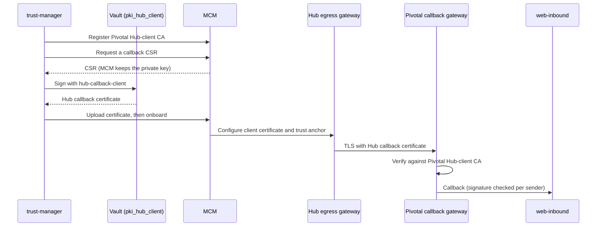

# Enable Hub-Facing Inbound mTLS and JWS (Leg 4)

> Applies to: Pivotal v1.4.0 and later, Helm chart 0.3.0 · Profile: both · Document version 1.0 (draft)

## Overview

Leg 4 carries the Hub's requests and callbacks to Pivotal's web-inbound service. Both sides
authenticate, and both certificates come from the **Pivotal Hub-client CA**:

| Certificate | Presented by | Issued by | Kept current by |
|---|---|---|---|
| web-inbound server certificate (Secret `pivotal-web-inbound-hub-tls`) | The Pivotal callback gateway | Vault role `pki_hub_client/roles/web-inbound-server` | cert-manager |
| Hub callback certificate | The Hub's egress gateway | Vault role `pki_hub_client/roles/hub-callback-client`, from a CSR MCM generates | trust-manager |

trust-manager registers the Pivotal Hub-client CA with MCM, signs the Hub callback certificate,
uploads it to MCM and asks MCM to onboard it, which configures the Hub's egress gateway. It renews the
certificate 30 days before it expires.

For JWS, web-inbound verifies the `fspiop-signature` on each request with the sender's public key:
peer DFSPs' keys are copied from MCM by trust-manager, Pivotal's own DFSPs' keys are already in the
database, and the Hub's key is registered by an operator. How strictly each sender is checked is set
**per sender**.



## Objective

Accept callbacks only from a caller presenting the Hub callback certificate, and verify their JWS
signatures at the strictness chosen for each sender.

## Expected Outcome

- The Pivotal callback gateway serves the web-inbound server certificate and requires a client
  certificate from the Pivotal Hub-client CA.
- The Hub holds a valid Hub callback certificate, renewed automatically.
- Callbacks for the test DFSPs arrive through the callback gateway.
- Senders you choose are verified in `verify-if-present` or `require` mode.

## Prerequisites

### Mandatory

- [Enable Hub-facing outbound mTLS and JWS](./enable-hub-facing-outbound.md) completed.
- The Hub operator's items H7 (the Hub's JWS public key) and H8 (egress gateway configured from MCM),
  from [Hub operator items and setup worksheet](hub-operator-and-worksheet.md#step-1-agree-the-hub-operators-items).
- DNS for the Pivotal callback host (`<PIVOTAL_CALLBACK_HOST>`) pointing to the ingress gateway. This
  must be the same host given to the ceremony as `WEB_INBOUND_HOST`: the two Vault roles accept no
  other name.
- The Vault role `pivotal-cert-manager` from your profile's Vault page
  ([vault-kv](../vault-kv/3-vault.md), [pkcs11](../pkcs11/4-vault.md)).
- cert-manager 1.12 or later (the issuer below uses `serviceAccountRef`).
- The saved Pivotal Hub-client CA root certificate from the ceremony (`pki_hub_client/root.pem`).
- `VAULT_ADDR` set in your shell.
- A portal account with `hub.signing-keys.update`, `participant.endpoint.register` and
  `participant.signing-keys.update`.

### Optional

- An Istio AuthorizationPolicy that allows the callback host only from the Hub egress gateway's
  address. The client certificate is checked anyway; this narrows who can try.

## Steps

### Step 1. Let cert-manager log in to Vault

- **Purpose:** cert-manager signs the web-inbound server certificate through Vault, as the
  ServiceAccount bound to the `pivotal-cert-manager` Vault role.
- **Action:** Create that ServiceAccount, and allow cert-manager to request tokens for it. Apply these
  resources with `kubectl apply -f`; they are not part of the Pivotal chart.
- **Command or Configuration:**

  ```yaml
  apiVersion: v1
  kind: ServiceAccount
  metadata:
    name: <CERT_MANAGER_VAULT_SA>
    namespace: <CERT_MANAGER_NAMESPACE>
  ---
  apiVersion: rbac.authorization.k8s.io/v1
  kind: Role
  metadata:
    name: <CERT_MANAGER_VAULT_SA>-token
    namespace: <CERT_MANAGER_NAMESPACE>
  rules:
    - apiGroups: [""]
      resources: ["serviceaccounts/token"]
      resourceNames: ["<CERT_MANAGER_VAULT_SA>"]
      verbs: ["create"]
  ---
  apiVersion: rbac.authorization.k8s.io/v1
  kind: RoleBinding
  metadata:
    name: <CERT_MANAGER_VAULT_SA>-token
    namespace: <CERT_MANAGER_NAMESPACE>
  subjects:
    - kind: ServiceAccount
      name: <CERT_MANAGER_CONTROLLER_SA>      # cert-manager's own ServiceAccount
      namespace: <CERT_MANAGER_NAMESPACE>
  roleRef:
    apiGroup: rbac.authorization.k8s.io
    kind: Role
    name: <CERT_MANAGER_VAULT_SA>-token
  ```

- **Expected Result:** Three resources created.
- **If It Fails:** Find cert-manager's own ServiceAccount with
  `kubectl -n <CERT_MANAGER_NAMESPACE> get deploy -o jsonpath='{..serviceAccountName}'`.

### Step 2. Issue the web-inbound server certificate

- **Purpose:** The Hub's egress gateway verifies this certificate with the Pivotal Hub-client CA,
  which MCM gave it.
- **Action:** Add a ClusterIssuer and a Certificate to your Helm values. The Certificate goes in the
  gateway's namespace, because Istio reads gateway credentials only from there.
- **Command or Configuration:**

  ```yaml
  certManager:
    clusterIssuers:
      enabled: true
      items:
        - name: pivotal-hub-server-issuer
          spec:
            vault:
              server: <VAULT_ADDRESS>
              path: pki_hub_client/sign/web-inbound-server
              auth:
                kubernetes:
                  role: pivotal-cert-manager
                  mountPath: /v1/auth/kubernetes
                  serviceAccountRef:
                    name: <CERT_MANAGER_VAULT_SA>
    certificates:
      enabled: true
      items:
        - name: pivotal-web-inbound-hub-tls
          namespace: <GATEWAY_NAMESPACE>
          spec:
            secretName: pivotal-web-inbound-hub-tls
            commonName: <PIVOTAL_CALLBACK_HOST>
            dnsNames: [<PIVOTAL_CALLBACK_HOST>]
            usages: [digital signature, key encipherment, server auth]
            duration: 2160h0m0s
            renewBefore: 360h0m0s
            privateKey: {algorithm: RSA, size: 2048, rotationPolicy: Always}
            issuerRef: {name: pivotal-hub-server-issuer, kind: ClusterIssuer}
  ```

  ```bash
  helm upgrade pivotal-stack <CHART> -n pivotal -f <VALUES_FILE>
  kubectl -n <GATEWAY_NAMESPACE> get certificate pivotal-web-inbound-hub-tls
  ```

- **Expected Result:** `READY` is `True` within a minute.
- **If It Fails:** `kubectl -n <GATEWAY_NAMESPACE> describe certificaterequest` shows Vault's answer:
  - `permission denied`: the Vault role, policy or ServiceAccount binding does not match.
  - `common name ... not allowed by this role`: `commonName` is not the host given to the ceremony.

### Step 3. Create the callback gateway's trust anchor

- **Purpose:** The gateway verifies the Hub callback certificate against this anchor. Nothing updates
  it automatically.
- **Action:** Combine the Pivotal Hub-client CA intermediate (from Vault) and root (from the
  ceremony) and create the companion Secret.
- **Command or Configuration:**

  ```bash
  { curl -s "$VAULT_ADDR/v1/pki_hub_client/ca_chain"; echo; cat <SAVED_PKI_HUB_CLIENT_ROOT_PEM>; } > hub-client-ca.pem
  kubectl -n <GATEWAY_NAMESPACE> create secret generic pivotal-web-inbound-hub-tls-cacert \
    --from-file=cacert=hub-client-ca.pem
  rm hub-client-ca.pem
  ```

- **Expected Result:** `secret/pivotal-web-inbound-hub-tls-cacert created`
- **If It Fails:** Check the file holds two certificates:
  `grep -c 'BEGIN CERTIFICATE' hub-client-ca.pem` prints `2`.

> Create this Secret by hand, not from Helm. A Secret rendered by Helm is reset on every upgrade.
> After a re-key of the Pivotal Hub-client CA, update it ([Re-key a Pivotal CA](../../runbooks/common/pivotal-ca-rekey.md)).

### Step 4. Configure the callback gateway and route

- **Purpose:** Serve the callback host with mandatory client certificates and route it to
  web-inbound.
- **Action:** Add these items to the existing `istio` lists in your values, then upgrade.
- **Command or Configuration:**

  ```yaml
  istio:
    gateways:
      items:
        - name: pivotal-hub-callback-gateway
          namespace: pivotal
          selector:
            <GATEWAY_SELECTOR_KEY>: <GATEWAY_SELECTOR_VALUE>
          servers:
            - hosts: [<PIVOTAL_CALLBACK_HOST>]
              port: {name: https-hub-callback, number: 443, protocol: HTTPS}
              tls:
                credentialName: pivotal-web-inbound-hub-tls
                mode: MUTUAL
    virtualServices:
      items:
        - name: pivotal-web-inbound-hub-vs
          namespace: pivotal
          gateways: [pivotal-hub-callback-gateway]
          hosts: [<PIVOTAL_CALLBACK_HOST>]
          http:
            - route:
                - destination: {host: web-inbound, port: {number: 3201}}
  ```

  ```bash
  helm upgrade pivotal-stack <CHART> -n pivotal -f <VALUES_FILE>
  ```

- **Expected Result:** See Verification tests 1 and 2.
- **If It Fails:** The host is not served until the Secret from Step 2 exists. Other hosts on the
  gateway are not affected.

> web-inbound's own `FSPIOP_USE_MUTUAL_TLS` stays `"false"`: the gateway terminates TLS.

### Step 5. Turn on the Hub callback certificate

- **Purpose:** trust-manager signs the Hub callback certificate and has MCM install it on the Hub's
  egress gateway.
- **Action:** Add the setting to trust-manager and upgrade.
- **Command or Configuration:**

  ```yaml
  trustManager:
    env:
      HUB_CALLBACK_CERT_COMMON_NAME: <PIVOTAL_CALLBACK_HOST>
  ```

  ```bash
  helm upgrade pivotal-stack <CHART> -n pivotal -f <VALUES_FILE>
  kubectl -n pivotal logs deploy/trust-manager --since=10m | grep -i 'callback certificate'
  ```

- **Expected Result:**

  ```text
  Hub callback certificate for '<PIVOTAL_CALLBACK_HOST>' checked every 24h, renewed 30 days before expiry.
  The Hub has no signed callback certificate for '<PIVOTAL_DFSP_ID>'; signing one.
  Signed and published the Hub's callback certificate for '<PIVOTAL_CALLBACK_HOST>' (enrollment <N>).
  ```

- **If It Fails:**
  - `Waiting for Pivotal's CA to be registered under '<PIVOTAL_DFSP_ID>' ...`: the CA registration job
    had not finished when this check ran. The check runs again only after 24 hours. Once the log
    shows `Registered the Pivotal CA with MCM for '<PIVOTAL_DFSP_ID>'.`, restart trust-manager to run
    it now.
  - `HUB_CALLBACK_CERT_COMMON_NAME is set, but signing needs Vault: set VAULT_ADDRESS.`: add
    `VAULT_ADDRESS`.
  - `The certificate is uploaded but onboarding '<PIVOTAL_DFSP_ID>' failed ...`: MCM could not
    configure the Hub. trust-manager retries at its next daily check, also after a
    restart. Ask the Hub operator to look at MCM; once fixed, they can publish it with `POST /dfsps/<PIVOTAL_DFSP_ID>/onboard` in MCM (the error
    message names this call).
  - `permission denied` from Vault: the `pivotal-trust-manager` policy lacks
    `pki_hub_client/sign/hub-callback-client`.

### Step 6. Point the test DFSPs' callbacks at the callback host

- **Purpose:** The Hub sends a DFSP's callbacks to the endpoint registered for it in the ledger.
- **Action:** For **one** test DFSP first, open **Participant → Register Endpoint**, and set the
  endpoint to `https://<PIVOTAL_CALLBACK_HOST>`. Or call `PUT /participant/endpoint` with
  `{"name": "<DFSP_ID>", "endpoint": "https://<PIVOTAL_CALLBACK_HOST>"}`. Run a transfer to that DFSP,
  then repeat for the others.
- **Expected Result:** The transfer completes, and the callback gateway's access log shows the Hub's
  requests on `<PIVOTAL_CALLBACK_HOST>`.
- **If It Fails:** Set the endpoint back to its previous value at once (see Rollback), then check
  Verification tests 1 to 3 and the Hub's egress logs with the Hub operator.

### Step 7. Turn on JWS verification

- **Purpose:** Reject forged or altered callbacks.
- **Action:**
  1. Register the Hub's JWS public key: **Hub → Hub JWS Public Key**, paste the PEM from the Hub
     operator (item H7 on
     [Hub operator items and setup worksheet](hub-operator-and-worksheet.md#step-1-agree-the-hub-operators-items)).
  2. Set `FSPIOP_USE_JWS: "true"` in `webInbound.env` and upgrade. This installs verification, but
     every sender starts in `off` mode, so nothing changes yet.
  3. Wait for trust-manager to copy peer DFSPs' keys from MCM. It runs every 300 seconds
     (`PEER_JWS_SYNC_INTERVAL_SECONDS`); web-inbound picks up a new key within about 5 seconds more.
  4. On **Participant → JWS Policy**, raise each sender's **Verify Mode** from `off` to
     `verify-if-present`. In this mode a present signature must be valid, and a missing one is still
     accepted.
  5. When a sender signs everything, raise it to `require`. Then a missing or invalid signature is
     rejected.
- **Command or Configuration:** `FSPIOP_JWS_VERIFY_MODE` on web-inbound applies **only** to senders
  that have no row on the JWS Policy page. Every DFSP and peer has a row, created with `off`, so the
  per-sender setting is what matters.
- **Expected Result:** The JWS Policy page shows the chosen mode for each sender.
- **If It Fails:** A sender that cannot be found on the JWS Policy page has no key record yet: for a
  peer, wait for the next sync; for the Hub, complete item 1.

> Leave the Hub in `verify-if-present` unless the Hub operator confirms the Hub signs everything it
> sends, including error callbacks.

## Verification

| # | Test | How | Pass |
|---|---|---|---|
| 1 | Server certificate | `openssl s_client -connect <PIVOTAL_CALLBACK_HOST>:443 -servername <PIVOTAL_CALLBACK_HOST> </dev/null 2>/dev/null \| openssl x509 -noout -subject -issuer` | Subject `CN = <PIVOTAL_CALLBACK_HOST>`; issuer the Pivotal Hub Client CA intermediate |
| 2 | No client certificate (negative) | `curl -sv https://<PIVOTAL_CALLBACK_HOST>/ 2>&1 \| grep -i alert` | Handshake refused ("certificate required") |
| 3 | A DFSP certificate is refused here (negative) | Repeat test 2 with a DFSP client certificate and key (`--cert`, `--key`) | Handshake refused: the DFSP CA is not trusted on this host |
| 4 | Hub callback certificate valid | trust-manager log from Step 5; ask the Hub operator for the certificate's end date in MCM | Signed, published, about one year of validity |
| 5 | Callbacks arrive | Step 6 | Transfer completes |
| 6 | Unsigned request rejected in `require` mode (negative) | Set a test sender to `require`, then send an unsigned request straight to web-inbound (below) | `Missing mandatory header: fspiop-signature.` |

Test 6:

```bash
kubectl -n pivotal exec deploy/web-outbound -- node -e '
fetch("http://web-inbound:3201/quotes", {method: "POST",
  headers: {"content-type": "application/vnd.interoperability.quotes+json;version=1.0",
            "fspiop-source": "<TEST_SENDER>", "date": new Date().toUTCString()},
  body: JSON.stringify({quoteId: "verification-test"})})
.then(async r => console.log(r.status, await r.text()));'
```

The request must have a non-empty body: a request without a body is never signed, so it is not
checked. Set the sender back to its previous mode afterwards.

**web-inbound does not log signature rejections.** A rejected request is visible only in the response
returned to the sender (`3105` gives HTTP 401). Ask the Hub operator to watch for these after each
mode change.

## Troubleshooting

- The failures in Steps 2 and 5.
- [Leg 4: Hub-facing inbound](../../troubleshooting.md#leg-4-hub-facing-inbound)
- [Trust-manager and MCM](../../troubleshooting.md#trust-manager-and-mcm)

## Rollback or Recovery

- **Callbacks failing after Step 6:** register each affected DFSP's previous endpoint again on
  **Participant → Register Endpoint**. This takes effect for the next callback.
- **Signatures rejected after a mode change:** lower that sender to `verify-if-present` or `off` on
  **Participant → JWS Policy**. web-inbound applies it within about 5 seconds.
- **Turn verification off entirely:** set `FSPIOP_USE_JWS: "false"` on web-inbound and upgrade.
- **Hub callback certificate:** it cannot be revoked by Pivotal. Removing `HUB_CALLBACK_CERT_COMMON_NAME`
  stops renewal; the certificate stays valid in MCM until it expires.

## References

- [Certificates and keys](../../concepts/certificates-and-keys.md)
- [Scheduled jobs](../../reference/scheduled-jobs.md)
- [Kubernetes resources](../../reference/kubernetes-resources.md)
- [MCM endpoints](../../reference/mcm-endpoints.md)
- Next: [End-to-end check](./end-to-end-check.md)
