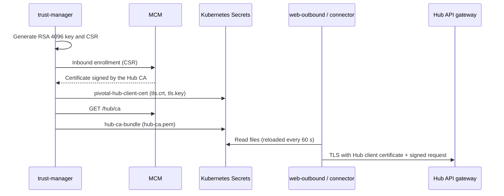

# Enable Hub-Facing Outbound mTLS and JWS (Legs 2 and 3)

> Applies to: Pivotal v1.0.1 – v1.3.0, Helm chart 0.2.0 · Profile: both · Document version 1.0 (draft)

## Overview

Legs 2 and 3 carry FSPIOP messages from Pivotal to the Hub:

| Leg | Sender | Messages | Signs as |
|---|---|---|---|
| 2 | web-outbound | `POST /quotes`, `POST /transfers` (and the unsigned `GET /parties`) | The payer DFSP |
| 3 | Each DFSP's connector | `PUT` callbacks for parties, quotes and transfers, and their error forms | The payee DFSP |

Both legs use the same two controls:

- **mTLS.** Pivotal presents the Hub client certificate (issued by the Hub CA through MCM and kept in
  Secret `pivotal-hub-client-cert` by trust-manager) and verifies the Hub's server certificate with
  the Hub CA bundle (Secret `hub-ca-bundle`).
- **JWS.** Pivotal signs each message with the DFSP's Hub JWS signing key. `GET /parties` is never
  signed: it has no body.



Signing is switched on in two places: the `FSPIOP_USE_JWS` setting on each service, and a per-DFSP
flag that trust-manager turns on only after MCM confirms it holds the DFSP's public key. That order
means Pivotal never signs with a key the Hub cannot yet check.

## Objective

Send every Hub-bound message over mTLS with the Hub client certificate, and sign every message that
has a body.

## Expected Outcome

- web-outbound and every connector complete a TLS handshake with the Hub API gateway using the Hub
  client certificate, and verify the gateway's certificate.
- Each onboarded DFSP shows `jwsSignEnabled: true`.
- The Hub receives `fspiop-signature` on quotes, transfers and callbacks from Pivotal's DFSPs.

## Prerequisites

### Mandatory

- Your profile's Deploy Pivotal page verified ([vault-kv](../vault-kv/4-deploy-pivotal.md),
  [pkcs11](../pkcs11/5-deploy-pivotal.md)): Secrets `pivotal-hub-client-cert` and `hub-ca-bundle`
  exist.
- [Enable DFSP-facing mTLS and JWS](./enable-dfsp-facing.md) completed.
- The Hub operator's items H5 and, if used, H6, from
  [Hub operator items and setup worksheet](hub-operator-and-worksheet.md#step-1-agree-the-hub-operators-items).
- The Hub operator has turned on JWS verification for Pivotal's DFSPs on the Hub side, or has agreed
  when to.
- One connector per test DFSP is deployed, configured for your profile by its onboarding runbook
  ([vault-kv](../../runbooks/vault-kv/onboard-dfsp.md) or [pkcs11](../../runbooks/pkcs11/onboard-dfsp.md)).
  A connector sends that DFSP's callbacks to the Hub (leg 3).

### Optional

- If the Hub runs in the same cluster and its public host name does not resolve inside the cluster:
  an Istio ServiceEntry for that host (Helm values `istio.serviceEntries`). Use
  `location: MESH_EXTERNAL`; `MESH_INTERNAL` makes the sidecar wrap the connection in mesh TLS and
  the gateway resets it.

## Steps

### Step 1. Check the Hub API gateway

- **Purpose:** Confirm the Hub side is ready before changing Pivotal.
- **Action:** Connect without a certificate, then check the gateway's certificate against the Hub CA
  bundle.
- **Command or Configuration:**

  ```bash
  curl -sv --max-time 10 https://<HUB_API_HOST>/ 2>&1 | grep -iE 'Request CERT|alert|certificate required'

  kubectl -n pivotal get secret hub-ca-bundle -o jsonpath='{.data.hub-ca\.pem}' | base64 -d > hub-ca.pem
  openssl s_client -connect <HUB_API_HOST>:443 -servername <HUB_API_HOST> -CAfile hub-ca.pem </dev/null 2>/dev/null \
    | grep 'Verify return code'
  rm hub-ca.pem
  ```

- **Expected Result:** The first command shows the server requesting a certificate and then a
  "certificate required" alert. The second prints `Verify return code: 0 (ok)`.
- **If It Fails:**
  - No certificate request: the host is not in mutual TLS mode, or another host on the same gateway
    (for example a wildcard) matched first. Ask the Hub operator.
  - Non-zero verify code: the gateway's server certificate does not chain to the Hub CA in MCM. Pivotal
    trusts only that CA, so the Hub operator must fix the certificate.

### Step 2. Configure web-outbound for mTLS

- **Purpose:** Point web-outbound at the Hub API gateway with the Hub client certificate.
- **Action:** Add the mounts and settings to `webOutbound` in your values file.
- **Command or Configuration:**

  ```yaml
  webOutbound:
    volumeMounts:
      - {name: hub-client-tls, mountPath: /etc/pivotal/hub-client-tls, readOnly: true}
      - {name: hub-ca, mountPath: /etc/pivotal/hub-ca, readOnly: true}
    volumes:
      - {name: hub-client-tls, secret: {secretName: pivotal-hub-client-cert}}
      - {name: hub-ca, secret: {secretName: hub-ca-bundle}}
    env:
      FSPIOP_PARTIES_URL: https://<HUB_API_HOST>
      FSPIOP_QUOTES_URL: https://<HUB_API_HOST>
      FSPIOP_TRANSFERS_URL: https://<HUB_API_HOST>
      FSPIOP_USE_MUTUAL_TLS: "true"
      FSPIOP_TLS_VERIFY_SERVER_CERT: "true"
      FSPIOP_TLS_VERIFY_DOMAIN: "true"
      FSPIOP_MTLS_CLIENT_CERT_PATH: /etc/pivotal/hub-client-tls/tls.crt
      FSPIOP_MTLS_CLIENT_KEY_PATH: /etc/pivotal/hub-client-tls/tls.key
      FSPIOP_MTLS_CA_PATH: /etc/pivotal/hub-ca/hub-ca.pem
      # Only if the Hub API gateway also requires a token (item H6). All three, or none.
      # FSPIOP_OAUTH_TOKEN_URL: <HUB_TOKEN_URL>
      # FSPIOP_OAUTH_CLIENT_ID: <HUB_TOKEN_CLIENT_ID>
      # FSPIOP_OAUTH_CLIENT_SECRET:
      #   valueFrom:
      #     secretKeyRef: {name: <SECRET_NAME>, key: <SECRET_KEY>}
  ```

  Notes:

  - Use file paths, not inline certificates. web-outbound re-reads the files every 60 seconds, so a
    renewed certificate is used without a restart.
  - Do **not** put `FSPIOP_USE_MUTUAL_TLS` in `global.commonFspiopEnv`. On web-inbound the same name
    means "serve TLS", and web-inbound then stops with
    `Mutual TLS is enabled but no server certificate is configured.`
  - Setting only one or two of the `FSPIOP_OAUTH_*` values stops web-outbound at startup.

- **Expected Result:** `helm template` shows the two volumes and the settings on the web-outbound
  Deployment.
- **If It Fails:** Check that the volume names under `volumeMounts` match those under `volumes`.

### Step 3. Configure each connector for mTLS

- **Purpose:** Callbacks (leg 3) leave from the connectors, not from web-outbound.
- **Action:** Add the same mounts and these settings to each entry in `connectors`.
- **Command or Configuration:**

  ```yaml
  connectors:
    - name: <DFSP_ID>-connector
      volumeMounts:
        - {name: hub-client-tls, mountPath: /etc/pivotal/hub-client-tls, readOnly: true}
        - {name: hub-ca, mountPath: /etc/pivotal/hub-ca, readOnly: true}
      volumes:
        - {name: hub-client-tls, secret: {secretName: pivotal-hub-client-cert}}
        - {name: hub-ca, secret: {secretName: hub-ca-bundle}}
      env:
        FSPIOP_PARTIES_URL: https://<HUB_API_HOST>
        FSPIOP_QUOTES_URL: https://<HUB_API_HOST>
        FSPIOP_TRANSFERS_URL: https://<HUB_API_HOST>
        FSPIOP_USE_MUTUAL_TLS: "true"
        FSPIOP_MTLS_CLIENT_CERT_PATH: /etc/pivotal/hub-client-tls/tls.crt
        FSPIOP_MTLS_CLIENT_KEY_PATH: /etc/pivotal/hub-client-tls/tls.key
        FSPIOP_MTLS_CA_PATH: /etc/pivotal/hub-ca/hub-ca.pem
  ```

  Notes:

  - The Java connector always verifies the Hub's certificate. It ignores `FSPIOP_TLS_VERIFY_*`.
  - It trusts **only** the CA file you give it, never the JVM's built-in authorities.
  - It reloads the certificate files every `FSPIOP_MTLS_RELOAD_INTERVAL_MS` (default 60000).
  - It needs a PKCS#8 private key. trust-manager writes the Hub client certificate's key as PKCS#8.

- **Expected Result:** Each connector Deployment renders with the volumes and settings.
- **If It Fails:** See Step 4.

### Step 4. Deploy and test the handshake

- **Purpose:** Prove the transport works before turning on signing.
- **Action:** Upgrade the release, then make one request from inside web-outbound using its mounted
  files.
- **Command or Configuration:**

  ```bash
  helm upgrade pivotal-stack <CHART> -n pivotal -f <VALUES_FILE>
  kubectl -n pivotal rollout status deploy/web-outbound --timeout=5m

  kubectl -n pivotal exec deploy/web-outbound -- node -e '
  const fs=require("fs"), https=require("https");
  const req=https.request({host:"<HUB_API_HOST>", port:443, path:"/parties/MSISDN/0", method:"GET", timeout:10000,
    cert:fs.readFileSync("/etc/pivotal/hub-client-tls/tls.crt"),
    key:fs.readFileSync("/etc/pivotal/hub-client-tls/tls.key"),
    ca:fs.readFileSync("/etc/pivotal/hub-ca/hub-ca.pem")},
    res=>{console.log("status "+res.statusCode+", server verified: "+res.socket.authorized); process.exit(0);});
  req.on("error",e=>{console.log("FAILED: "+e.code+" "+e.message); process.exit(1);});
  req.end();'
  ```

- **Expected Result:** `status <code>, server verified: true`. Any HTTP status passes, including a
  `400` about missing FSPIOP headers or a `401` asking for a token: the Hub's application answered,
  so the TLS handshake succeeded in both directions.
- **If It Fails:**

  | Output | Cause |
  |---|---|
  | `FAILED: ECONNRESET` before TLS | A ServiceEntry with `MESH_INTERNAL`, or connecting past a listener that expects the PROXY protocol |
  | `FAILED: UNABLE_TO_VERIFY_LEAF_SIGNATURE` or `SELF_SIGNED_CERT_IN_CHAIN` | The gateway's certificate does not chain to `hub-ca-bundle` (Step 1) |
  | `FAILED: ERR_TLS_CERT_ALTNAME_INVALID` | `<HUB_API_HOST>` is not a name on the gateway's certificate |
  | Handshake alert `certificate required` | The files are not mounted, or the Secret is empty |

  For a connector, read its log after restart: `kubectl -n pivotal logs deploy/<DFSP_ID>-connector --tail=100`.

### Step 5. Turn on signing

- **Purpose:** Sign leg 2 and leg 3 messages.
- **Action:**
  1. Set `FSPIOP_USE_JWS: "true"` in `webOutbound.env` and in each connector's `env`. Each connector
     also needs its profile's key settings from its onboarding runbook; a connector with
     `FSPIOP_USE_JWS: "true"` and no Vault settings stops at startup.
  2. Upgrade the release.
  3. Restart each connector **after** its DFSP's key exists. A Java connector reads its key once, at
     startup. A connector that finds no key sends **unsigned** callbacks and logs a warning; it does
     not fail.
- **Command or Configuration:**

  ```bash
  helm upgrade pivotal-stack <CHART> -n pivotal -f <VALUES_FILE>
  kubectl -n pivotal rollout restart deploy/<DFSP_ID>-connector
  kubectl -n pivotal logs deploy/trust-manager --since=2h | grep -E "published to MCM|different signing key"
  ```

- **Expected Result:** For each DFSP, one of:

  ```text
  '<DFSP_ID>' is published to MCM and signing is now enabled.
  '<DFSP_ID>' was published to MCM but never switched on; signing is now enabled. Its provisioning announcement was missed.
  ```

  The second appears when trust-manager's hourly sweep, rather than the onboarding message, switched
  the DFSP on.

- **If It Fails:**
  - `MCM holds a different signing key for '<DFSP_ID>' than Pivotal does.`: trust-manager will not
    overwrite it and keeps signing off. Find out which key is correct before you change anything.
  - Nothing logged after an hour: the DFSP has no `self` row with a public key. Re-check its
    onboarding.
  - Connector log `No JWS signing key at Vault path '...'. Outbound FSPIOP callbacks will be sent unsigned.`
    (vault-kv): no key exists at that path. Check `VAULT_JWS_KEY_PATH_PREFIX` and `CONNECTOR_ID`,
    and that the DFSP has been onboarded. A Vault policy problem shows as a Vault error at startup
    instead.
  - Connector log `No key reference at Vault path '...'. The crypto user exists but no key has been provisioned.`
    (pkcs11): the DFSP's key was not provisioned, or `CONNECTOR_ID` does not match. See
    [Onboard a DFSP (pkcs11)](../../runbooks/pkcs11/onboard-dfsp.md), Step 3.

### Step 6. Confirm each DFSP's signing flag

- **Purpose:** Signing needs both the service setting and the per-DFSP flag.
- **Action:** In the portal, open **Participant → JWS Policy** and load each DFSP. Or call
  `GET /participant/jws-policy?fspId=<DFSP_ID>` on web-pivotal.
- **Expected Result:** `role` is `self`, `hasPublicKey` is `true`, `jwsSignEnabled` is `true`.
- **If It Fails:** If trust-manager reported a key mismatch, do not switch the flag on by hand.
  Otherwise you can enable signing on this page once MCM holds the right key.

## Verification

| # | Test | How | Pass |
|---|---|---|---|
| 1 | Handshake | Step 4 | `server verified: true` |
| 2 | Signed messages reach the Hub | Run a transfer from `<DFSP_A>` to `<DFSP_B>`. Ask the Hub operator to check the Hub's logs for that transfer | `fspiop-signature` present on `POST /quotes` and `POST /transfers` from `<DFSP_A>`, and on the `PUT` callbacks from `<DFSP_B>`. `GET /parties` is unsigned; that is correct |
| 3 | Both legs used mTLS | The Hub API gateway's access log for the transfer | Requests from web-outbound and from the connector on the mTLS host |
| 4 | No certificate, no entry (negative) | Step 1, first command | Refused at TLS |
| 5 | Wrong CA refused (negative) | Repeat the Step 4 handshake with `ca` pointing to any other CA file | `FAILED: ... UNABLE_TO_VERIFY_LEAF_SIGNATURE` (or a similar verification error) |

For the full transfer check, see [End-to-end check](./end-to-end-check.md).

## Troubleshooting

- The tables in Steps 4 and 5.
- [Legs 2 and 3: Hub-facing outbound](../../troubleshooting.md#legs-2-and-3-hub-facing-outbound)
- [Trust-manager and MCM](../../troubleshooting.md#trust-manager-and-mcm)

## Rollback or Recovery

- **Signing:** set `FSPIOP_USE_JWS: "false"` on web-outbound and the connectors and upgrade. To stop
  signing for one DFSP only, untick signing for it on **Participant → JWS Policy**; trust-manager does
  not switch a DFSP back on once it has been enabled before.
- **mTLS:** set `FSPIOP_USE_MUTUAL_TLS: "false"` and point the `FSPIOP_*_URL` values back to the
  previous Hub endpoints, then upgrade.
- **Hub client certificate:** it cannot be revoked by Pivotal. trust-manager renews it 30 days before
  expiry; to force a new one, delete Secret `pivotal-hub-client-cert` and restart trust-manager.

## References

- [Certificates and keys](../../concepts/certificates-and-keys.md)
- [Environment variables](../../reference/environment-variables.md)
- [Scheduled jobs](../../reference/scheduled-jobs.md)
- [MCM endpoints](../../reference/mcm-endpoints.md)
- Next: [Enable Hub-facing inbound mTLS and JWS](./enable-hub-facing-inbound.md)
